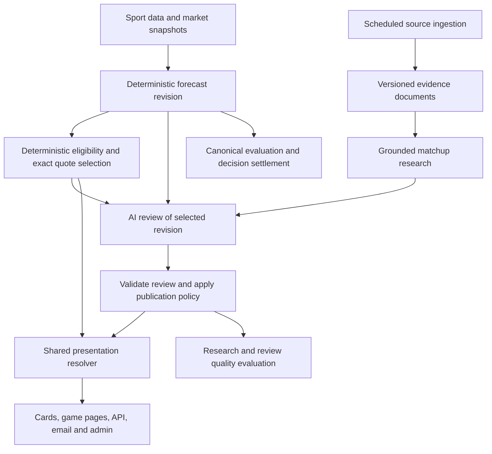

# Multi-sport research, prediction, and AI review

Status: shared multi-sport implementation added behind disabled-by-default execution gates; production rollout has not been performed.

Audit date: November 20, 2026, America/Chicago.

### Implementation progress — P0/P1 foundation

The first implementation slice adds:

- `tests/Fixtures/prediction-review-baselines.json` and `Tests\Support\PredictionReviewFixtures`: explicitly synthetic, reusable fixtures covering all seven sports, season metadata, canonical/legacy identity, spread conventions, stored approvals, and NFL interpretation ceilings. These are regression inputs, not production sports evidence.
- `PredictionReviewInputBuilder::forGame`: an internal read-only entry point that uses the existing selected delivery source. It records canonical or legacy table/record identity, public ID, revision, event, season, calculation run and input snapshot. It never falls back to legacy after canonical coverage is withdrawn.
- `PredictionReviewInput`: a readonly input DTO keeping the primary projection separate from version-checked frozen NFL recommendation evidence. Canonical delivery uses positive home margin and also retains the source home spread; legacy values retain their existing stored convention without a speculative conversion.
- Canonical review ceilings sourced only from the existing public approval reader, preserving exact decision IDs, side, line, price, observation time, and its existing freshness/withdrawal/tracking restrictions. Other legacy sports explicitly report an unsupported decision adapter instead of inferring approval from AI output.
- `PredictionReviewDecisionPolicy`: an interpretation ceiling that retains deterministic selections and rejects AI-supplied prices/sides/approvals. NFL delegates to the existing publishing policy, including its classification normalization, watch/pass behavior, and optional guardrails. Legacy NFL contract generation also delegates to the existing payload builder unchanged.

At the end of that initial slice, these classes were not wired into scheduled daily review, generation, public resources, or publication. That slice introduced no migrations, provider calls, configuration changes, schedule changes, entitlement changes, or production activation. Existing NFL payload schemas and hashes remained untouched. The subsequent integration below builds on this foundation.

Validation: 185 focused local tests passed (2,593 assertions) using explicitly selected SQLite in memory. This includes the new 49-case input/policy suite plus existing daily review, NFL research costs and decision safety, NFL research endpoint access, canonical/legacy API selection, permission gating, endpoint contracts, and canonical betting workflow suites. The new cases include Central/UTC midnight and DST handling. Targeted PHP formatting passed. No production coverage, settings, latency, spending, or source-health baseline was collected; the P0 runtime baseline remains a pre-activation task. Additional public-payload/research-state fixtures and evidence-requirement adapters can extend this initial P0/P1 slice without activating a new writer.

Run the new fixture/contract suite locally with an uncached testing configuration:

```bash
APP_ENV=testing DB_CONNECTION=sqlite DB_DATABASE=:memory: DB_URL='' CACHE_STORE=array QUEUE_CONNECTION=sync \
  bash scripts/php85.sh artisan test --compact tests/Feature/Predictions/PredictionReviewInputTest.php
```

### Subsequent implementation — shared research, execution, and application integration

Parallel implementation added the following capabilities:

| Area | Implemented entry points and behavior |
| --- | --- |
| Shared research | `GameResearchService::assess/forGame`, capability registry, approved source/document store, immutable evidence-scoped assessments, and descriptive adapters for all seven sports. NFL delegates to existing research calculations without initiating a new provider call. |
| Source operations | `sports:ingest-research-document` supports explicit source registration and activation, local exact-excerpt ingestion, and optional allowlisted fetching. No real source catalog was guessed or registered. Event-bound documents cannot leak into a same-team doubleheader. |
| Review execution | `PredictionReviewCoordinator`, `PredictionReviewRunner`, `ReviewFingerprint`, and `ReviewSpendAdmission` manage durable pending/queued/running/deferred/failed work, immutable results, atomic claims, replacement inputs, fair bounded dispatch, reserved attempts, circuit-aware delayed retries, and paid-result crash recovery. Normal work uses one structured interpretation call. |
| Read applicability | `CurrentPredictionReview` rebuilds selected forecast/approval input and evidence fingerprints before showing a saved review. Withdrawn approvals, model/prompt changes, expired evidence, and superseded results cannot appear as a current review. Deterministic selection summaries are separate from labeled AI interpretation. |
| Orchestration | `RefreshGameAnalysis`, `sports:reconcile-game-analysis`, `sports:reconcile-prediction-reviews`, and `sports:run-prediction-reviews` separate source assessment, desired work, and execution. Gated after-commit publication hooks and gated Central-time schedules are installed but disabled by default. |
| Ownership | Explicit shared-review activation for a sport suppresses that sport's old daily AI writer and saved legacy AI read path. It does not change model calculations, approval records, or NFL research writer ownership. Authorized retries retain active work and accounting; queued automatic work cannot swallow an explicit admin retry. |
| Application/API | The new admin-only `/api/v2/sports/{sport}/games/{game}/analysis/research` read contract serves safe research and current review summaries. A protected admin POST queues retries. Six non-NFL game pages share a lazy research panel; the existing NFL section and endpoints are retained. OpenAPI, client types, access checks, and endpoint contracts were updated together. |
| Operations | `sports:report-game-analysis` reports recorded work states, overdue unfinished work, source health, saved unexpired results, and known versus unknown review usage without purchases or mutations. These observations are not claims of complete slate coverage or current betting eligibility. |

The additive schema is in `2026_11_20_230100_create_prediction_review_work_tables.php` and `2026_11_21_010000_create_shared_research_storage.php`. Both run in disposable in-memory test databases during validation; neither was applied to production or the local persistent application database by this task.

Configuration is separated into `config/research.php`, `config/prediction_review.php`, and `config/game_analysis.php`. Existing production environment values and existing NFL flags remain unchanged. New automatic execution and per-sport capabilities default off. Subscriber research access, provider web discovery, research-driven numerical adjustments for new sports, production migrations, and live source activation remain separate rollout decisions.

Budget admission is deliberately described precisely: new review requests atomically reserve estimated spend against the recorded application ledger. Existing legacy research and narrative admission remains independent. This is not a hard cap on all concurrent provider billing. Unknown or timed-out usage remains reserved rather than reported as free.

Operational instructions: [multi-sport research](operations/multi-sport-research.md) and [prediction reviews](operations/prediction-review.md). Before activation, collect the P0 runtime baseline, approve actual source catalogs and capacities, apply additive schema, verify workers and default gates, replay fixtures, and activate a single sport under the documented rollback procedure. Historical NFL revisions remain available through compatibility reads; no backdated forecasts or historical approval upgrades are manufactured.

Final local verification: **4,586 PHP tests passed across 43 isolated batches**, including unit, every feature directory, top-level feature tests, and all architecture checks. The complete NFL batch passed 1,146 tests. The native publication lifecycle suite also passed 16 tests, including four new combinations of automatic-dispatch and sport capability flags. The shared/NFL frontend access and presentation suites passed eight tests; full `npm run quality:check` and the Vite production build passed.

The single-process PHP suite exceeded 512 MB late in its run. Launching with a higher limit did not resolve that because an existing CFB training command sets the in-process limit back to 512 MB; isolated batches completed successfully without modifying that command or application settings. Targeted formatting for implementation files passed. Repository-wide Pint still flags the pre-existing local artifact `outputs/nfl-epa-validation-2026-11-20/preview-runner.php`, which was left untouched. Test-batch details were saved locally at `/private/tmp/picksports-game-analysis-test-results.json`.

## 1. Scope and evidence boundary

This audit traces the current working-tree implementation of pregame game-level predictions, sourced matchup research, AI review, publication, and presentation across NBA, NFL, MLB, CBB, WCBB, WNBA, and CFB. The working tree contains substantial existing modifications; findings describe the files inspected, not a clean Git release or verified production deployment.

The audit used repository source, migrations, schedules, documentation, and existing test definitions. It did not call production, inspect credentials, fetch outside sports evidence, invoke AI providers, run ingestion or generation, run migrations, change feature flags, or execute the test suite. References below are repository-relative and resolve to the inspected implementation. Runtime coverage, enabled production gates, worker capacity, provider billing, and actual source reliability remain unverified.

The implementation scope is a common lifecycle with sport-specific evidence and eligibility policies. Player props remain a separately scoped market workflow: link their context and preserve exclusions, but do not expand paid prop research or alter prop models as an incidental part of this project. Futures, live betting models, model calibration, and challenger promotion are outside the initial rollout.

## 2. Outcome and design rules

Users should see one coherent account of a game: the current model forecast, any eligible betting selection with its stored price, supporting research, the main concerns, and honest update times. Cards, boards, game pages, APIs, and reports must agree for the same observation time, forecast revision, market, and permission scope.

1. Model calculations own projections and probabilities. Preserve the distinction between canonical primary forecasts, frozen recommendation calculations, research scenarios, and historical legacy rows.
2. Deterministic application policies own market eligibility, approval, holds, source freshness, and quote suitability. An AI response cannot grant betting approval.
3. Research stores sourced evidence and interpretation. Completion, grounding, freshness, and eligibility are different properties.
4. AI review explains and challenges supplied evidence. A supported concern may yield a structured request for a deterministic policy to hold or downgrade; a model response is never a direct authority to publish a stronger bet.
5. Every review is tied to an exact forecast identity, evidence set, quote context, and execution specification. Numeric IDs from different tables are never interchangeable.
6. Read endpoints only read. Provider calls, source refreshes, and regeneration require explicit background or authorized operational workflows.
7. Reuse the existing event, forecast, validation, market, source-grounding, and AI telemetry infrastructure. Do not build a second prediction platform or a generic workflow engine.
8. Preserve historical records and existing approval statuses. Expansion begins with descriptive research; new numerical effects require a separate versioned calculation and validation effort.

## 3. Audited current flow

### 3.1 Forecast creation and source selection

- [SportsPipelineRegistry](../app/Services/Sports/SportsPipelineRegistry.php) supports seven sports and `sync`, `predict`, `full`, `live`, and `ai` modes. `full` combines sync and predict; it does not include the AI steps. The `ai` mode separately invokes daily prediction analysis and operations review.
- Prediction steps vary by sport. NFL calls `nfl:run-pregame-pipeline`; other sports use their generation stages and additional sport-specific work. Canonical selection and retirement are gated; support in source does not prove production activation.
- [PredictionLifecycleOrchestrator](../app/Services/Predictions/PredictionLifecycleOrchestrator.php) manages immutable input snapshots, calculation runs, and canonical revisions. [PredictionPublisher](../app/Services/Predictions/PredictionPublisher.php) checks successful matching calculation output, guards pregame publication time, supersedes the prior publication, and invalidates view caches. It does not require the daily AI review.
- [SportPredictionReader](../app/Services/Api/V2/SportPredictionReader.php) selects canonical or legacy API reads. [PredictionDeliverySource](../app/Services/Predictions/PredictionDeliverySource.php) and [BettingForecastSource](../app/Services/Predictions/BettingForecastSource.php) already adapt selected forecasts for delivery and betting consumers. These are the starting points for review identity, rather than another hard-coded model map.
- The NFL pregame command runs canonical generation/readiness, stored-data research assessments with `--no-ingest --no-web`, and research readiness. Its direct research call does not authorize paid research. Separate scheduled revision processing may call the research provider.

### 3.2 NFL evidence and research

- [OfficialSourceIngestor](../app/Services/NFL/Research/OfficialSourceIngestor.php) polls configured team sites, uses conditional requests, deduplicates document contents, handles roster/injury material, and restricts fetches and redirects. Team hosts and policy defaults live in [nfl_research.php](../config/nfl_research.php).
- Source and document storage is NFL-specific: `nfl_research_sources`, `nfl_research_documents`, and `nfl_research_revisions`. [SportsGameContextReport](../app/Models/SportsGameContextReport.php) is sport-keyed, but its current research producer is NFL-specific.
- [ResearchPipeline](../app/Services/NFL/Research/ResearchPipeline.php) selects a stored forecast baseline, builds evidence and a non-persisting recommendation preview, checks quarterback availability and market coverage, optionally obtains a context report, previews prop context, and records a deduplicated immutable assessment revision. It preserves a missing-baseline hold and separates refresh failures from pick eligibility.
- In canonical mode its baseline reads frozen `recommendation_context` from the selected native forecast. It is not simply a copy of the canonical primary forecast. This distinction must survive migration.
- [NflWebContextResearchService](../app/Services/NFL/NflWebContextResearchService.php) supports supplied-source analysis and optional provider web discovery. Supplied-source mode is the configured default; the class name does not mean every call performs a web search. It enforces source availability, report reuse, provider cooldown, per-game locking, spend admission, normalization, claim grounding, two-sided evidence, and uncertainty handling.
- [ResearchRefreshPolicy](../app/Services/NFL/Research/ResearchRefreshPolicy.php) fingerprints evidence and candidate changes. The current configured freshness defaults are 2,160 minutes at all pregame stages, capped at kickoff; source and market freshness have separate policies. These NFL defaults are not appropriate implicit defaults for every sport.
- [ResearchSpendGuard](../app/Services/NFL/Research/ResearchSpendGuard.php) reserves rolling estimated spend, counts unknown usage conservatively, and protects pregame capacity. Its accounting is scoped to the NFL research purpose, not all application AI calls or the provider account.
- [ResearchPipelineCommand](../app/Console/Commands/NFL/ResearchPipelineCommand.php) rotates attempted games across batches, reports remaining coverage, and distinguishes completed assessments, holds, and processing failures. This is stronger coverage handling than daily AI review and should be preserved.

### 3.3 Shared daily AI review

- [AnalyzeDailyPredictionsWithAiCommand](../app/Console/Commands/Sports/AnalyzeDailyPredictionsWithAiCommand.php) has a hard-coded map to legacy sport prediction models. It selects scheduled games by a business-date window and optional season, loads the matching rows, and applies an attempt limit per sport. There is no explicit query ordering or persisted work backlog.
- The same-day existing analysis lookup uses sport, legacy prediction ID, market, and execution-day `as_of_date`. An unchanged payload skips before consuming the batch allowance. Subsequent runs can therefore advance; the limit alone does not mean the first batch is always repeated.
- A changed input invokes main analysis followed by four optional assessments: freshness, market readiness, model audit, and publishing guardrail. With all enabled, that is five provider calls per prediction, before retry calls or separate research/narrative work.
- [SportsAiPredictionPayloadBuilder](../app/Services/Predictions/SportsAiPredictionPayloadBuilder.php) includes model outputs, odds, operational context, external research context, existing prose, and a prediction snapshot. NFL additionally receives a deterministic decision contract and the latest stored research revision. The payload hash omits generated timestamps and an odds-age field; provider/model/prompt identity is not part of the command's skip comparison.
- [SportsAiContentService](../app/Services/AI/SportsAiContentService.php) records the main daily analysis through `AiGenerationRecorder`; the four supporting assessment methods inspected do not use that recorder. They return an assessment or null and log failures. Null does not distinguish disabled, deferred, malformed, and failed stages in the saved review.
- Rate-limit handling can stop the remaining run. The final exit status is failure only when rate limiting occurred and zero predictions were processed; other skipped failures and partial coverage may return success.
- [SportsAiPublishingDecisionPolicy](../app/Services/Predictions/SportsAiPublishingDecisionPolicy.php) caps NFL review output against a deterministic contract. Other sports retain the AI recommendation/classification after optional guardrail enforcement. Guardrail enforcement defaults off; an enabled guardrail with no assessment does not automatically produce a hold.
- Reviews are saved with `updateOrCreate` into [SportsAiPredictionAnalysis](../app/Models/SportsAiPredictionAnalysis.php). The daily unique key overwrites same-day results for a legacy prediction, so it is not an immutable history of all review revisions.

### 3.4 Scheduling as defined, not verified execution

Source: [routes/console.php](../routes/console.php). Times below are intended Central business times; implementation must confirm the relevant scheduler helper/default timezone when consolidating schedules.

| Work | Definition observed | Coverage consequence |
| --- | --- | --- |
| MLB daily AI review | 09:05 in season; default limit 25; default single date | One bounded daily opportunity; later changes need another trigger |
| WNBA daily AI review | 03:25 in season; default limit 25; default single date | Same limitation |
| NFL daily AI review | 08:50, 11:50, 14:50, 17:50, 20:50 in season; seven days forward; limit 4 | Repeated batches, but no explicit fairness/deadline ordering |
| NFL source ingestion | Every 15 minutes; limit 8 teams; research enabled | Independent source work, no AI required for ingestion |
| NFL research revisions | Minutes 07, 22, 37, 52; seven days forward; limit 4 | Fair rotation, source/cost/cooldown gates still apply |
| NFL research readiness | Minutes 05 and 35; two days forward | A readiness observation, not generation or approval |
| NFL research grading | Hourly at minute 55; bounded final revisions | Separate from canonical prediction evaluation |
| NBA/CBB/WCBB/CFB daily review | No direct `sports:ai-daily-predictions` schedule found in this file | Manual/shared `ai` mode exists; repository capability is not automatic coverage |

There is also a legacy NFL game-context research schedule gated on the newer research pipeline being disabled. Consolidation must preserve that mutual exclusion until its replacement is verified.

### 3.5 Read APIs and application presentation

- [routes/api-v2.php](../routes/api-v2.php) exposes a generic-looking `/sports/{sport}/games/{game}/research` route, but [NflResearchController](../app/Http/Controllers/Api/V2/NflResearchController.php) rejects non-NFL sports. The route currently requires admin and NFL prediction-related permissions. It returns up to twenty saved revisions.
- Admin retry routes, [NflResearchRetryController](../app/Http/Controllers/Api/V2/Admin/NflResearchRetryController.php), and [RetryGameResearch](../app/Jobs/NFL/RetryGameResearch.php) are NFL-specific. They use queue/lock ownership, recheck admin and pregame eligibility, and expose transient cache-backed status.
- [PredictionResourcePreparer](../app/Services/Predictions/PredictionResourcePreparer.php) attaches legacy AI analyses. NFL requires a matching current payload hash; other sports take the latest stored analysis without that match.
- Canonical reads use [CanonicalPredictionPresentationService](../app/Services/Api/V2/CanonicalPredictionPresentationService.php) and [CanonicalSportPredictionResource](../app/Http/Resources/Api/V2/CanonicalSportPredictionResource.php). That inspected resource does not attach the legacy `ai_analysis` field. The canonical and legacy presentation paths therefore do not currently have one shared review contract.
- [NflPredictionBoardContext](../app/Services/NFL/NflPredictionBoardContext.php) already distinguishes archived, missing, refresh-blocked, expired, changed, and reviewed research and protects stored pregame market display. It is attached by the legacy [SportPredictionPresentationService](../app/Services/Api/V2/SportPredictionPresentationService.php), not the inspected canonical presentation service.
- [NflResearchBrief.vue](../resources/js/components/game-page/NflResearchBrief.vue) presents supporting evidence, risks, lineup concerns, source links, and prop context. [NFL/Game.vue](../resources/js/pages/NFL/Game.vue) currently makes this research section admin-only. Do not treat expanding research coverage as permission to expose it to subscribers.
- Frontend helpers such as [predictionBoardPresentation.ts](../resources/js/lib/predictionBoardPresentation.ts) and [usePredictionCardRecommendation.ts](../resources/js/composables/usePredictionCardRecommendation.ts) contain multiple classification sources and AI fallbacks. Presentation policy is partly reconstructed in the browser.
- Narratives are a separate path. [PredictionNarrativeService](../app/Services/Predictions/PredictionNarrativeService.php) supports canonical deterministic prose and legacy template/optional AI prose; [GeneratePredictionNarrative](../app/Jobs/Predictions/GeneratePredictionNarrative.php) supports both identities. Do not assume every explanation is generated by daily review or merge them blindly.

## 4. Findings and priorities

Priorities identify implementation order, not confirmed production incidents.

| ID | Priority | Finding and impact | Required change |
| --- | --- | --- | --- |
| A1 | P1 | Daily AI review selects legacy rows while public readers can select native revisions. A successful run cannot establish review coverage of the published source. | Resolve the same selected forecast as delivery; attach exact source/revision identity. |
| A2 | P1 | Non-NFL legacy readers can expose reviews after forecast/market changes; canonical resources have a different review surface entirely. | Shared freshness resolver and presentation contract for both source paths. |
| A3 | P1 | NFL caps AI classifications deterministically, while other sports can retain AI-generated betting classifications. Frontend AI fallbacks can affect presentation. | Universal deterministic approval ceiling and one effective decision read model. |
| A4 | P2 | Daily review has no durable pending/deferred/failed inventory, no explicit fair ordering, and incomplete success semantics. Failed or frequently changing early rows can consume batches. | Durable work, deadline-aware fair dispatch, explicit run accounting. |
| A5 | P2 | Review reuse ignores requested provider/model and prompt/policy revisions; same-day updates overwrite prior results. | Versioned execution fingerprint and immutable review revisions. |
| A6 | P2 | Four supporting AI calls repeat objective checks, lack equivalent per-call telemetry in the inspected methods, and can fail to null without a complete stage result. | Deterministic preflight; one normal review call; separately measured optional audits. |
| A7 | P2 | Research source ingestion, evidence selection, schemas, refresh, budget purposes, commands, grading, retry, routes, and UI are tied to NFL. | Shared infrastructure with explicit sport capabilities and adapters. |
| A8 | P2 | `SportsExternalGameContextBuilder` returns zero adjustment components for non-NFL but still derives a scenario probability using the NFL spread coefficient. This is an expansion hazard if another sport starts producing reports. | No generic probability conversion; sport calculators alone may produce scenario projections. |
| A9 | P2 | Several paths use latest-by-game research; the daily payload adds the latest research revision directly rather than a single shared eligibility resolver. | Resolve evidence freshness, grounding, candidate identity, and display eligibility once. |
| A10 | P2 | Spend reservations cover NFL research, not the whole research/review/narrative chain. More sports can increase both provider cost and queue contention without a shared capacity plan. | Global and per-sport/purpose admission, fair scheduling, full usage accounting. |
| A11 | P2 | Admin-only NFL routes and screens cannot simply become a shared subscriber feature. Raw briefs can include internal operational metadata. | Separate public research summaries from protected diagnostics and write controls. |
| A12 | P3 | Registry `full`, scheduled prediction runs, research assessment, narrative generation, and `ai` mode are separate orchestration concepts. Names and completion messages can imply broader coverage than they prove. | Stage definitions, explicit contracts, and documentation matching actual ownership. |

Preserve existing strengths: immutable canonical forecasts, frozen market lineage, read-only source selection, grounded NFL evidence, supported partial research, conservative unknown-cost accounting, per-game locks, fair NFL rotation, bounded grading, explicit missing-baseline holds, and historical-versus-executed-wager distinctions.

## 5. Proposed end-to-end flow



This is a dependency graph, not one synchronous transaction. A safe forecast can publish while research is pending. Research can gather facts before a forecast exists. Evidence-based model changes, if introduced later, create a new versioned calculation input and forecast revision; they never mutate the baseline under review.

### 5.1 Ownership and proposed shared components

Names are proposed implementation seams, to be reconciled with existing classes before coding.

| Responsibility | Reuse | New or extended seam |
| --- | --- | --- |
| Sport/event resolution and calendars | `SportContextResolver`, `SportEvent`, `SportsDateWindowService` | Research capability registry: horizons, topics, source coverage, policy versions, rollout flags |
| Selected forecast and market interpretation | `PredictionDeliverySource`, `BettingForecastSource`, canonical query | Shared review input DTO that preserves source identity, phase, signs, units, and frozen recommendation context |
| Source acquisition | Existing NFL ingest protections and documents | Shared source/document repository and fetch service; sport-owned source catalogs/parsers |
| Evidence selection | NFL `EvidencePacket`, grounding and uncertainty rules | `ResearchEvidenceBuilder` interface with a typed sport-specific context payload |
| Research production | Research client, recorder, refresh and spend controls | Shared `GameResearchService`; NFL adapter first, other sports by capability |
| Review production | Main structured analysis agent and payload builder | `PredictionReviewService`; no implicit market approval |
| Eligibility/publication | Existing betting/approval services and sport rules | Shared decision contract and publication policy; sport adapters supply requirements |
| Read presentation | Existing API/resource and delivery preparation | `GameAnalysisPresentation` resolver batched for slate reads |
| Operations | Existing queues, locks, heartbeats, telemetry | Durable work records and coverage reporting, rather than a new workflow platform |

### 5.2 Identity and data model

Use additive migrations and explicit foreign keys. Proposed tables should be finalized after checking current production schema/index capacity through authorized read-only access during implementation.

- **Sources and documents:** shared `research_sources`, versioned `research_documents`, and document/entity associations. Scope source keys by sport and stable team/player identity; do not use abbreviations as cross-sport keys. Documents may support multiple teams or games. Preserve URL, content hash, publication time, first observation, last successful check, parser version, provenance, and source failure separately. A successful poll does not make old article content newly published.
- **Research reports:** evolve `sports_game_context_reports` additively where practical; add nullable event identity and schema/policy versions. Treat new results as immutable report revisions, with facts and interpretations carrying document/claim references. Preserve ready and grounded-partial distinctions. Do not require a forecast ID for independent evidence gathering.
- **Assessment revisions:** a shared `game_research_assessments` table links report/evidence identity to an exact forecast, frozen recommendation context, quote set, eligibility outcome, and any explicitly labeled scenario. Keep NFL revision IDs and legacy import mapping; do not relabel old previews as canonical primary outputs.
- **Review revisions:** a shared `prediction_review_revisions` table records immutable review results. Use separate nullable canonical-prediction and legacy-source references with an application-enforced exactly-one-source invariant and relevant DB checks where supported. Include sport event, market scope, calculation/input lineage, quote identity, evidence fingerprint, execution specification, predecessor, structured output, and publication disposition. Preserve integer legacy references and canonical public IDs independently.
- **Work and attempts:** `analysis_work_items` identifies durable desired work for research or review; claim lease, priority, deadline, next attempt, terminal reason, and desired fingerprint are mutable orchestration fields. Individual attempts link to `ai_generations`; no need to duplicate token usage in multiple ledgers. Preserve state transitions sufficiently to diagnose retries and stalls.
- **Decisions:** link existing approval/decision records and their exact quotes. Add a small immutable publication-assessment record only if existing records cannot represent the effective review disposition. Do not create a competing betting approval ledger.

Database uniqueness must cover event/source, stage, market, semantic input, and execution fingerprint. Index pending/next-attempt/deadline queries and batch read lookups. Retain immutable financial and model lineage indefinitely according to existing policy; define separate retention for raw source bodies, attempts, and diagnostics before enabling large college slates.

### 5.3 Separate state dimensions

| Dimension | Proposed states | Meaning |
| --- | --- | --- |
| Execution | pending, queued, running, succeeded, deferred, failed, cancelled | Whether work ran, with retry time/reason and lease ownership |
| Research content | ready, partial, unavailable | Whether grounded evidence is adequate for its stated purpose |
| Applicability | current, outdated, expired, superseded, archived | Whether saved content applies to the selected inputs and observation time |
| Betting disposition | approved, lean, watch, pass, hold | Deterministic eligibility; approved requires an actual existing approval record |
| Evidence requirement | required, optional, unsupported | Per sport/topic/market; unsupported is distinct from failed or missing |

Do not overload `hold` to mean provider failure or use `succeeded` to mean approved. Detailed reason codes belong in structured data; user-facing labels are derived centrally.

### 5.4 Input and execution fingerprints

Maintain separate hashes:

1. **Evidence hash:** stable document/content and verified availability/context identities, relevant event metadata, and evidence policy version.
2. **Forecast/review input hash:** selected source and revision, calculation/input snapshot, deterministic decision contract, material quote context, evidence/report linkage, and scope exclusions.
3. **Execution hash:** provider, model, prompt/schema versions, enabled stage specification, and normalization/publication policy versions.

Ignore retrieval timestamps and array order where they are not semantic; retain actual observation times for freshness. Repeated input with the same execution hash reuses the saved result across calendar boundaries while valid. A model or prompt change can create a desired new review without requiring `--force`.

Research need not be purchased again for a market-only change: reuse grounded documents/report, rerun deterministic quote eligibility, and request a new interpretation only when its material inputs change. Exact quote lineage and current eligibility must still be checked even if cost-control bucketing suppresses a new AI call. Expiry and invalidation are evaluated on reads as well as by background jobs; a stable content hash never makes stale evidence current.

### 5.5 Review and publication policy

Normal flow: deterministic data/market preflight, reusable grounded research, one structured AI interpretation, deterministic output validation, effective publication assessment. Move objective freshness and market completeness checks out of repeated AI calls. Retain model-audit/guardrail agents as explicitly enabled sampled or anomaly-triggered diagnostics until evidence justifies their removal; they cannot quietly remain five paid calls per normal review.

| Situation | Forecast | Betting selection | Research/review presentation |
| --- | --- | --- | --- |
| Safe model inputs; optional research pending or provider down | Publish under existing model rules | Existing deterministic approval may remain eligible | Show model explanation and pending/unavailable research; never claim reviewed |
| Required verified availability input missing | Publish only if model policy permits, with qualification | Hold affected markets | State the concrete evidence gap |
| Research current; AI asks for a stronger tier or different market | Preserve model outputs | Reject promotion/change; retain existing eligibility ceiling | Store rejected suggestion in diagnostics |
| AI identifies a source-backed material concern | Preserve revision | Deterministic policy validates concern and can hold/downgrade | Explain the accepted concern with evidence |
| Review points to superseded forecast or stale quote | Serve current selected forecast | Re-evaluate existing approval against current quote | Exclude old review from current explanation; retain history |
| Current forecast explicitly withdrawn or approval expired | Follow existing withdrawal policy | Suppress affected selection | Recheck before cached presentation or queued email delivery |
| Game starts, is cancelled, or postponed | Use explicit phase/status policy | Stop pregame admission and expire pregame eligibility as applicable | Archive pregame assessment; reschedule new work only under explicit rules |

Do not make AI availability a universal publication gate. Required evidence gates are sport/market-specific deterministic rules. Preserve current defaults until each replacement policy passes parity checks.

### 5.6 Execution, capacity, and costs

- Forecast publication and material evidence changes enqueue desired work after commit. Scheduled reconciliation discovers missing, expired, abandoned, or missed work. Polling remains a recovery mechanism rather than the only trigger.
- Use bounded per-item queued jobs, shared leases, uniqueness by desired fingerprint, and completion-time compare-and-swap. A result for an old forecast can be stored historically but cannot attach to the newer revision.
- Admission prioritizes unreviewed required work and approaching starts, then outdated work, with aging and per-sport quotas to prevent one sport or failing game from monopolizing capacity. Keep deterministic tie-breaking by start time and event identity. Preserve NFL rotation until the replacement proves fair coverage.
- Use delayed retry with bounded exponential backoff and jitter; honor provider Retry-After where available. Do not sleep within a slate-wide command or let one failed game stop unrelated sports. Provider-wide quota exhaustion can pause admission globally while work remains visible as deferred.
- Add global application and per-sport/purpose/event rolling estimated budgets and attempt caps, using atomic reservations. Separate source ingestion, supplied-source AI analysis, optional web discovery, review, and narrative usage. Reserve late pregame capacity and account for manual retries through the same admission service.
- Unknown/timeout usage retains conservative reservations. Record every paid attempt, including malformed outputs and supporting audits. Estimates are not provider billing guarantees. Do not change model choices or pricing assumptions during the structural migration.
- Capacity planning uses eligible events × material updates × enabled calls, retry reserve, observed latency, worker concurrency, and deadlines. Set numeric limits only after measuring existing usage; college slates need explicit coverage tiers and admission limits.
- Admin run status exposes eligible/current/pending/deferred/failed/expired counts, deadline misses, oldest pending age, per-stage latency, token usage, estimated and unknown cost, and source health. Separate a successfully completed assessment from a fully drained slate and a financially approved selection.

## 6. Sport expansion contracts

All seven sports appear in the capability registry from the start. An adapter can explicitly report unsupported or insufficient source coverage without emitting invented findings. New sports initially have no research-driven numerical adjustment and no new approval authority.

| Sport | Initial research topics to support when evidence exists | Specific requirements |
| --- | --- | --- |
| NFL | Quarterback availability, personnel, official injuries, coaching/starter plans, weather, line context | Preserve existing grounding, QB uncertainty, frozen recommendation context, and pregame grading semantics |
| NBA | Verified availability/starting lineups, rotations, rest/travel, recent performance | Differentiate confirmed lineup from projected lineup; tipoff-aware expiry; sources for reported restrictions |
| MLB | Probable/confirmed starters, confirmed batting lineup, bullpen workload, park/weather/roof context | Distinct event identity for doubleheaders; pitcher/lineup replacement invalidation; support F3/F5 only through separately declared capabilities |
| WNBA | Availability, lineups/rotations, rest/travel, matchup performance | Independent source catalog and coverage, not inherited NBA availability assumptions |
| CBB | Availability, expected roles, rest/travel, venue/tournament context, recent performance | School-specific source quality, neutral sites, team identity resolution, incomplete injury coverage explicitly reported |
| WCBB | Same topic families as college basketball with its own sources | Preserve separate team/league identities and current eligibility policy; no assumption of CBB source parity |
| CFB | Quarterback/personnel availability, depth charts, coaching/starter information, weather, opponent context | Preserve existing FBS scope and season/week handling; distinguish official reports from supplemental depth charts |

Recommended order: extract NFL without behavior change, add NBA to prove a different sport family, add MLB to prove baseball identity and lineup semantics, then WNBA, CBB/WCBB, and CFB according to source readiness and capacity. Rollout order is configurable; initial research coverage is descriptive until each adapter has validated policy support.

## 7. Application and API experience

### 7.1 One read model

Build a batched shared presentation resolver used by canonical and legacy resources, dashboard cards, prediction boards, game-page data, digest preparation, and reports. Backend policy supplies effective selection and classification; browser helpers format rather than re-decide. Distinguish different permission scopes and observation times when testing parity.

Proposed additive contract sections:

```json
{
  "forecast": { "source": "canonical", "id": "public-id", "revision": 3 },
  "selection": {
    "status": "hold", "approval_id": null, "market": "spread",
    "side": "home", "line": -3.5, "price": -110,
    "quote_observed_at": "...", "reason_codes": ["required_lineup_unconfirmed"]
  },
  "research": {
    "status": "partial", "applicability": "current", "assessed_at": "...",
    "evidence_as_of": "...", "expires_at": "...", "report_id": "...",
    "supporting": [], "concerns": [], "unresolved": [], "sources": []
  },
  "review": { "status": "pending", "reviewed_at": null, "summary": null }
}
```

This is an illustrative shape, not a committed endpoint contract. A quoted candidate on hold is not a playable/approved selection; the final schema must distinguish candidate quote display from approved selection explicitly. Omitted permission-gated fields remain omitted or consistently null according to the established API convention. Raw documents, internal requesters, execution identifiers, cost data, and provider exceptions do not enter the public summary.

### 7.2 Screens

- **Prediction card:** model pick/projection, effective selection when eligible, one concise explanation, primary concern, and relevant update time. No overlapping AI/model badges suggesting two competing approvals.
- **Game overview:** selected forecast, selection/market facts, key supporting evidence and risk. Optional research pending must not blank a valid model explanation.
- **Matchup research:** reusable section with supporting findings, opposing findings, unresolved questions, and numbered sources. Sport adapters provide topic labels and structured content; do not copy the NFL component seven times.
- **History:** archived pregame assessments retain their original forecasts and quotes. Make revised research scenarios explicit; never show a live/current line as a historical entry quote.
- **Admin:** source health, coverage, attempt history, pipeline stages, budget deferrals, and authorized retry. Retry is a POST, uses the same admission controls, and remains separate from normal navigation/polling.

Keep current admin-only research access during backend extraction. Subscriber-facing research is a later explicit entitlement decision with redacted summary resources and negative authorization tests. Use neutral availability text; do not present an LLM confidence score as a win/cover probability.

### 7.3 Route migration

Keep the existing research route operational for NFL under current access rules. Introduce shared controller/resource/query support behind per-sport flags, explicit capabilities, bounded pagination, and sport-appropriate authorization. Keep old retry URLs as compatibility adapters while adding a shared admin contract. Do not remove the NFL permission middleware before equivalent shared policies are tested.

Update OpenAPI, endpoint contracts, shared TypeScript types, API client methods, and entitlement handling together. Reading research or mounting a screen must not enqueue paid work. Invalidate caches when effective decision/research applicability changes, and recheck withdrawal/approval state before serving cached prose and sending queued messages.

## 8. Implementation sequence

Each work package is independently reviewable. No package is executed by this document. Deliver additive schema first, then compatible readers/writers, then per-sport activation. Sizes are relative, not calendar estimates.

| Package | Size | Dependencies | Implementation and exit criteria |
| --- | --- | --- | --- |
| **P0 — Baseline and contract fixtures** | M | None | Capture representative canonical/legacy payload fixtures for all seven sports, permission tiers, and current NFL research states. Verify source selection, signs/units, kickoff/date handling, approval identities, and enabled production gates through authorized read-only evidence before rollout. Record baseline coverage/cost/latency without provider refreshes. Exit: accepted parity matrix and reproducible fixtures. |
| **P1 — Shared identity and decision contract** | M | P0 | Adapt existing delivery/betting forecast readers for review inputs; preserve primary versus recommendation calculations. Define effective market decision and evidence requirements per sport. Remove AI approval authority only through separately tested policy changes. Exit: no cross-table ID collisions, no sign/unit drift, no AI promotion beyond existing approval. |
| **P2 — Additive storage and telemetry** | L | P1 | Add shared source/document associations, assessment/review revisions, durable work, and required lineage fields. Record every provider attempt through one ledger; define retention and indexes. Exit: migrations pass architecture guards and disposable-DB upgrade checks; old readers remain compatible. |
| **P3 — NFL infrastructure extraction** | L | P2 | Wrap existing source catalog/parsers, evidence/grounding, uncertainty, refresh, locks, budgets, and grading behind shared interfaces. Preserve legacy record mappings and source protections. Compare replayed stored evidence without provider calls. Exit: NFL fixture parity for findings, dispositions, freshness, revisions, source failures, and force/budget behavior. |
| **P4 — Review execution and reconciliation** | L | P1, P2 | Add per-item jobs, semantic/execution fingerprints, fair deadlines, lease recovery, bounded retries, global/per-sport budgets, and complete coverage counts. Add commands as thin adapters. Exit: large slate drains fairly under controlled capacity; no duplicate paid admission or stale-result publication; partial success is visible. |
| **P5 — Simplified review policy** | M | P3, P4 | Deterministic preflight plus one normal interpretation call; supporting agents become explicit optional diagnostics. Separate research production from review and prose rendering. Run replay/shadow comparison before switching. Exit: all calls measured, no hidden stage failures, cost/quality comparison documented, provider outage follows defined fallback. |
| **P6 — Shared read/API contract** | L | P3–P5 | One batched presentation resolver for canonical/legacy forecasts; exact revision/research applicability; admin research endpoint compatibility; permission-safe public summary contract. Exit: stale content excluded, existing endpoints remain compatible, query counts bounded, OpenAPI and TypeScript agree. |
| **P7 — Application integration** | M | P6 | Shared research component and consistent card/board/game labels, history, fallback prose, admin coverage and retry. Migrate emails/reports to the same effective decision. Exit: mobile/desktop/accessibility checks and cross-surface parity; browsing never purchases research. |
| **P8 — NBA pilot** | M | P3–P7 | Add source catalog, evidence topics, lineup/availability semantics, refresh rules, and descriptive reports. Start admin-only and disabled by default. Exit: stored-fixture grounding tests, measured source coverage, budget/deadline report, no new numerical adjustments or approvals. |
| **P9 — MLB and remaining adapters** | L, split by sport | P8 | Add MLB doubleheader/pitcher/lineup semantics, then independently gated WNBA, CBB, WCBB, and CFB support. Large college slates require capacity and source-coverage acceptance. Exit per sport: full contract suite, entitlement parity, declared unsupported fields, stable costs. |
| **P10 — Cutover and retirement** | M | Verified P3–P9 per sport | Activate one writer/dispatcher per stage and sport, verify current read coverage, drain old queues, retain old command/route adapters as needed, then remove unused chains in later changes. Exit: no duplicate provider spend, preserved history, documented rollback, no remaining active consumers of retired paths. |

Suggested first coding change after plan approval: P0 fixtures and P1 identity/contract work. Do not begin by copying the NFL pipeline or raising batch limits.

## 9. Migration, rollout, and rollback

1. **Expand:** create additive tables/nullable lineage fields and compatible readers; deploy schema before workers. Follow `docs/engineering.md` expand-first requirements. Never repurpose `prediction_id` to refer to a different table.
2. **Map history:** import or reference old NFL/AI rows in bounded resumable batches with an immutable mapping. Mark historical rows lacking exact lineage as historical/unverified; do not manufacture pregame-safe evidence or attach them by matching integer IDs. Keep old grading references intact.
3. **Replay:** compare new adapters using archived source bodies, stored input snapshots, quotes, and recorded AI output. Replay must not create a second paid provider call.
4. **Shadow:** allow new read models and deterministic policies to compute comparisons, with one active paid execution owner. If a paid comparison is explicitly enabled later, admit and tag it through the same global budgets.
5. **Activate per sport:** independent capability/source-ingestion/research/review/presentation gates, defaulting to compatibility behavior until verified. AI/research activation must not toggle canonical readers, model releases, calibration, or approval gates.
6. **Observe:** verify current revision linkage, source freshness, deadline coverage, worker failure recovery, permissions, and spend. A deployment or successful command is insufficient evidence of a healthy slate.
7. **Rollback:** disable new admission and presentation for the affected sport, drain/cancel owned pending work safely, and use the last compatible read path only if its forecast source remains valid. Never revive a retired legacy forecast writer or display stale review content to create an apparent recovery. Preserve new records, active reservations, provider attempts, and historical mappings.
8. **Contract later:** remove legacy readers/writers or tighten nullability only after zero-use checks, worker drain, and documented verification. Keep historical endpoints or adapters according to API deprecation policy.

## 10. Validation plan

Existing tests to retain and extend include `tests/Feature/Sports/AiDailyPredictionsCommandTest.php`, NFL research pipeline/grounding/quality/reliability/cost-control suites, API research/retry authorization tests, canonical publication/reader tests, scheduling guardrails, and `tests/frontend/nflResearchAccess.test.mjs`. These were inspected as source evidence, not run for this planning task.

| Area | Required scenarios |
| --- | --- |
| Identity | Canonical/legacy numeric ID collision; superseded revision while job runs; frozen recommendation context versus primary forecast; withdrawn forecast; historical rows without lineage |
| Sport semantics | All seven sports; season crossover; NFL regular/postseason filters; college neutral sites and FBS scope; UTC/Central midnight and DST; postponed/delayed/cancelled games; MLB doubleheaders and pitcher replacement |
| Evidence | Unchanged content after fresh poll; missing publication time; stale/partial/contradictory evidence; unsupported topics; unverified citations; document changes; source failure; disallowed redirects/URLs; source text containing prompt instructions |
| Freshness and reuse | Same inputs on a new calendar day; changed model/prompt/schema/policy; market-only change; report expiry with stable hash; late lineup change; old result arriving after new revision |
| Eligibility | No quote, stale quote, unpaired quote, changed price, expired/withdrawn approval; AI upgrade/wrong market; supported concern downgrade; optional research outage; required evidence unavailable; no invented calibration |
| Work execution | Concurrent scheduler/manual retries; duplicate dispatch; lease timeout/recovery; crash after reservation; result persistence retry; provider outage/429/quota; malformed output; budget cap; fairness across sports and failing items |
| Presentation | Same effective decision across cards, board, game page, API and email for equal scope/time; current versus archive quote; no stale AI summary; explicit pending/unavailable; mobile/keyboard states; no misleading AI probability |
| Access and performance | Admin versus subscriber denial/redaction; tier changes during polling; no writes on GET; batched reads; large college slate memory/query limits; authorized retry remains budget-controlled |
| Accounting | All provider calls recorded; timeout/unknown costs retained; rollup reconciles with attempts; process completion versus held result versus full coverage; tracking versus actual wagers unchanged |

Use faked providers and frozen times for deterministic tests. For implementation, run focused safe-local tests, PHP formatting, relevant frontend checks, API/OpenAPI generation checks, and required architecture migration checks; broaden only when affected behavior warrants it. Paid provider smoke checks and production activation are separate authorized operational steps, not prerequisites for a source-only plan.

## 11. Acceptance gates and decisions

The foundation is ready when:

- A review always identifies the selected forecast, calculation lineage, applicable research, and quote context without legacy/canonical ambiguity.
- One deterministic effective decision drives all consumers; no AI score or frontend fallback can create approval.
- Every eligible event within the configured horizon has a visible current, pending, deferred, failed, unsupported, or overdue disposition. Batch limits never erase backlog.
- Research evidence can be reused without another provider purchase when interpretation inputs have not materially changed; stale evidence and changed forecast linkage remain explicit.
- All paid calls share measurable admission/accounting; worker retries and manual operations cannot bypass spend caps.
- NFL retains existing grounded evidence, holds, uncertainty, history, and budget behavior through extraction.
- NBA demonstrates a second sport without NFL schemas, coefficients, permissions, or assumptions leaking into its output.
- Cards, boards, game pages, API responses, and queued delivery use compatible contracts and safely handle missing permissions or analysis.

Recommended defaults for implementation: descriptive research first; preserve current research entitlements; optional research never universally blocks a valid forecast; required sport/market evidence can hold a selection; one normal AI interpretation call; optional web discovery disabled until explicitly configured; independent rollout gates for every sport.

Before activation, record concrete decisions for source catalogs, per-topic freshness windows, which evidence is required for each market, per-sport deadlines and budgets, and whether subscriber research access will be introduced. These choices need observed source/capacity evidence; this plan does not invent numerical service levels or silently change the existing access policy.

## 12. Documentation to update during implementation

Update the owning documents in the same packages as behavior changes: `docs/agents-and-operations.md`, `docs/model-lifecycle.md`, `docs/codebase-reference.md`, `SCHEDULER_REFERENCE.md`, NFL research/cost-control runbooks, API endpoint contracts/OpenAPI, and a shared multi-sport research operations guide. Correct the current conceptual flow diagram where it implies that all published forecasts pass through daily AI review. Keep this plan as the audit and sequencing record; operational truth belongs in the maintained guides and implementation.

## NBA rollout preparation — November 20, 2026

Read-only Cloud inspection confirmed the active production target and absent shared tables/flags. The [NBA rollout runbook](operations/nba-research-rollout.md) provides exact staged activation and feature rollback, with [redacted metadata evidence](operations/nba-rollout-preflight-2026-11-20.json). No production settings or data were changed. Official NBA injury PDF provenance was verified; a fresh reviewed pilot packet and source-refresh operation remain activation gates.

Preparation fixed URL override fetch/store provenance, NBA stale legacy review visibility after rollback, application-timezone event reconciliation, and shared job timeout bounds below the existing 120-second worker. These changes preserve the original NFL ownership and worker configuration. Production migration execution and backup recovery verification remain pending approval.
