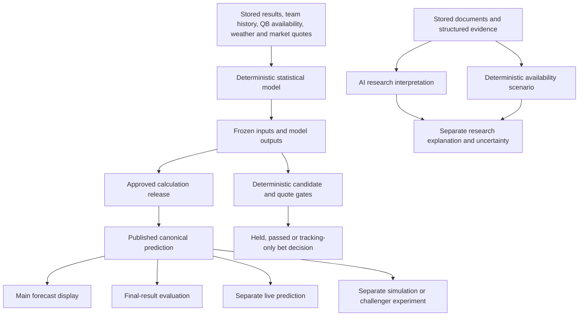

# NFL prediction authority and end-to-end review

Reviewed November 25, 2026 against main `88e12ff4` plus the isolated custom EPA cleanup. Production was inspected read-only at 18:49 Central. Changes described as local require deployment. No research, provider refresh, training, simulation, grading or publication was triggered by this review.

## The product contract

The statistical model calculates a winner estimate, home margin and combined total. AI explains supplied evidence and can support restrictions; it does not author the published numerical forecast or grant a wager approval. A published prediction is not an approved bet. Research scenarios, live updates and experiments are separate outputs with separate identities.

## Production facts verified

| Setting or identity | Observed value | Meaning |
| --- | --- | --- |
| Canonical pipeline / reads, NFL | Both enabled | Native canonical records are the current transport |
| Approved pregame calculation release | ID 27, version 1.3.0, type `rules` | This is not a deployed learned-model artifact |
| Forecast source | `frozen_nfl_model_v1` | Preserves outputs of the existing statistical model |
| Forecast model version | `nfl-historical-elo-v2-career-regular-v2-ats-v3-season-adaptive-v1-integrity-v4` | Distinct from calculation-release version 1.3.0 |
| Custom EPA quarantine | Enabled | Custom same-game-fitted EP excluded from prediction blend |
| Market blend | Enabled | Forecast is not independent of sportsbook lines |
| Rolling efficiency / opponent-adjusted efficiency | Both disabled | Existing implementations must not be advertised as active numerical inputs |
| NFL research | Enabled | Configuration permits research; this alone does not prove freshness or a successful paid invocation |
| Shared prediction-review master / NFL flag | Master on, NFL off | Separate shared AI review is not active for NFL under this configuration |

These observations are a point-in-time configuration check, not a claim that every game has complete source coverage. The query did not expose credentials. Provider/model configuration does not prove actual inference activity.

## Source-to-result ownership

| Stage | Owning implementation | Authority and checks |
| --- | --- | --- |
| Data and team metrics | ESPN/nflverse ingestion, `CalculateTeamMetrics`, QB availability and point-in-time history services | Current-season completed samples and availability evidence; missing data is not zero |
| Base and adjusted model | `GeneratePredictionFromHistoricalElo::previewPregame` | Elo and home field, season-adaptive prior, enabled QB/trench/context/weather/injury layers, point calibration, market blend, win-probability calibration and configured tweaks |
| Input capture | `NflInputSnapshotBuilder`, `NflRecommendationInputBuilder` | Frozen model outputs, configuration hash, QB identity, analysis eligibility and paired market evidence; snapshot does not call an LLM |
| Release calculation | `NflCalculator`, `NflFullModelReleaseDefinition` | Release 1.3 preserves frozen spread/total/win outputs; missing/invalid values throw rather than falling back silently |
| Immutable publication | `PredictionLifecycleOrchestrator`, `CanonicalPrediction` | Versioned release/run/input/output identities, publication transitions and canonical records |
| Recommendations | `NflCanonicalDecisionRecorder`, `NflCandidateDecisionPolicy` | Deterministic consensus, pregame verified snapshot, paired fresh quote, selection/line/price, and data holds; records tracking-only/nonpublic decisions |
| Research | `ResearchPipeline`, `EvidencePacket`, `NflWebContextResearchService` | Structured documents and verified availability feed a deterministic scenario; LLM prose does not supply numerical adjustments. Locks, freshness, grounding and spend controls remain |
| AI review | `PredictionReviewRunner`, `PredictionReviewDecisionPolicy` | Separate enablement, bounded work items, input fingerprints and deterministic ceiling; cannot upgrade approval or invent prices/probabilities |
| Narratives | `PredictionNarrativeService::canonicalNarrative` | Canonical path returns a deterministic template from the stored forecast and approved decisions; availability of an AI agent class does not mean this path calls it |
| Public/API readers | `SportPredictionReader`, canonical presentation, `NflPredictionBoardContext` | Published canonical forecast is the main output; research status and scenario are distinct |
| Live | `UpdateLivePrediction`, `LivePredictionStore` | Baseline plus clock/score state; separate snapshot, never an overwrite of the pregame record |
| Simulation | `Simulation/GameSimulationService` | Separate score-distribution experiment, same-model history requirements and provisional holds; not a drive-by-drive engine or automatic forecast replacement |
| Forecast grading | `EvaluateCanonicalPrediction`, `CanonicalTeamGameEvaluator` | Recorded final result evaluated against a pregame canonical prediction |
| Bet and experiment grading | Bet settlement, signal observations, prop-probability experiment | Separate line/price settlements and prospective metrics; do not combine reconstructed history with prospective calibration |

The name `feature_version=nfl-pregame-ml-v3`, stored feature vectors and weekly challenger training do not establish that learned ML is running the primary forecast. The verified rules release consumes frozen deterministic outputs. A trained challenger needs its own identified approved artifact, frozen inputs, evaluation and explicit release change before it can replace that authority.

## Calculation conventions

- Internal `predicted_spread` in the historical model is **home margin**. Canonical spread market `projected_line` is the negative of home margin: margin +4.8 means home sportsbook line −4.8.
- Win probability is for the home team. Favorite confidence is not a spread-cover probability or confidence in evidence quality.
- Total means combined game points. Deriving team points from total and margin is an arithmetic illustration, not a separately fitted score model.
- Market blending makes model/market agreement correlated. Preserve the pre-market output when evaluating independent model value.
- An adaptive calibration function having run is not proof of prospective probability calibration or profitability.
- Rule matches, player grades and experimental custom EP ratings are not independent validated betting edges.
- `recommendation_context.forecast_role=recommendation_evidence_only` is a historical compatibility key. In full-model release 1.3 those frozen outputs also supply the primary forecast. Added `calculation_method` and `ai_numeric_authority` make the numerical boundary explicit without rewriting old snapshots.

## Findings and local corrections

1. **Custom EP leaked through metrics and public display despite forecast quarantine.** Local cleanup suppresses public values, removes NFL EPA ranking/display options, skips quarantined calculations and scheduled jobs, preserves raw aggregates, and adds a bounded admin-only experimental view. Separate nflverse EPA remains unchanged.
2. **Research scenarios could replace the canonical card forecast.** Local board correction retains scenarios in `research_scenario` with source/time and makes canonical cards fall back to published numbers. Forecast grading and main display now share their forecast authority. The legacy reader retains its prior override for compatibility and labels it a research-adjusted model scenario.
3. **Model/AI roles were not explicit enough.** Added deterministic/non-AI metadata and a short forecast-card explanation. Canonical narrative generation is already templated; shared NFL AI review is disabled in the inspected production settings.
4. **Two forecast implementations coexist.** The historical calculation engine remains the full-model numerical producer, while the canonical lifecycle is the storage/release transport. The simpler 1.2 calculator and legacy publication path remain compatibility paths. Deleting them during this review would risk historical tests and other release readers; they are not evidence of two independently agreeing models.
5. **Large calculation class and repeated context logic remain maintainability risks.** It is over 4,000 lines. Extracting pure stages with unchanged frozen-output fixtures is a separate refactor; do not adjust weights while extracting code.

## Remaining limits and next work

- No finding here validates model quality, cover probabilities, profitability, or a learned-model promotion. Run a separate same-input, pregame-frozen benchmark against market-only and simple Elo baselines before making performance claims.
- Freshness, starter identity, injuries, source coverage and paired quotes remain per-game gates. This review did not certify every record in production.
- Preserve compatibility paths until use is measured. Consolidate writers/readers incrementally; never delete frozen records or backfill new assumptions into old observations.
- Record a dedicated custom-rating calculation timestamp and immutable research snapshot before resuming any controlled custom EP evaluation; the admin view currently states calculation time is unknown.
- The research scenario is separately available in the API. A richer comparison UI should show published versus scenario with the exact changed availability inputs, without adopting the scenario as the primary prediction.
- Production configuration is not changed by this branch. Review and deploy the local changes before expecting the display fixes or stopped background work on the live site.

## Validation

Focused suites cover custom metric masking/storage, disabled manual EPA work, admin authorization, API null-key compatibility, canonical frozen-output preservation and board research separation. Frontend checks cover metric ranking/display and NFL forecast/board presentation. Executed focused suites: 296 PHP tests (canonical lifecycle/board, prediction API contracts, cleanup/admin metrics, AI review/research boundaries) and 48 frontend tests passed. Frontend formatting, ESLint, typechecking and production asset build passed after generating local Wayfinder helpers. See `outputs/nfl-system-review-2026-11-25.json` for production configuration evidence. These are focused checks, not a full repository CI pass.

## Follow-up hardening in the isolated branch

The parallel end-to-end review found and corrected concrete boundary defects without changing configured model weights:

- Totals-only odds and 100% model-side weighting preserve existing winner-probability adjustments. Invalid numeric lines are unavailable rather than zero. Normal home/away spread signs remain unchanged.
- New recommendation captures record the raw market payload hash and exact selected book/line. Canonical capture rejects a mismatch with the frozen snapshot or a selected line without fresh paired quote evidence, including stale-first-book/fresh-second-book payloads.
- Numerical model identity advances to `integrity-v5`; old version-specific calibration observations are not silently pooled into the corrected model. Historical snapshots are unchanged. The production observation table above still describes the inspected v4 release, not deployed v5 behavior.
- Research reuse rejects future timestamps and wrong-event or wrong-sport reports. Bet quote pairing checks identity and pregame capture time on both sides; malformed provider timestamps fail closed.
- Pregame snapshot timing, canonical reader/grading integrity and pinned-live baseline identity are checked at their boundaries. A foreign-event live baseline or an invalid higher forecast revision must not replace valid pregame evidence.
- Scheduler regression coverage confirms custom EP jobs are absent during quarantine while independent nflverse and prospective prop jobs remain registered.

Release review must preserve both the calculation release identity and the corrected underlying forecast model version. Register and approve the reviewed code/configuration through the existing release workflow before enabling it in production; never relabel old outputs with the new version. Fail-closed cases can reduce apparent coverage until upstream quotes or source identities are corrected; these holds are preferable to silently treating malformed evidence as current.

### Reviewed release activation boundary

The corrected full-model release is **1.3.1**, distinct from the inspected production **1.3.0**. The registration CLI now defaults to 1.3.1; explicit historical versions remain readable and their approval evidence is not rewritten. New captures carry `nfl-market-isolation-integrity-v5`, and the calculator rejects publishing those captures under full-model 1.3.0. Until an operator registers/approves 1.3.1 through the normal release workflow, updated generation fails closed while previously valid published forecasts remain readable. This branch has not activated or deployed that release.

Read-only production preflight at 19:12 Central on November 25 inspected 15 upcoming published NFL records and found no run/output-hash, input-identity, capture/cutoff/kickoff or source-after-capture violations in those checked predicates. It did not certify every historical record or quote path.

### Final integrated verification

After all source changes were frozen, all four PHP shards passed. The repository suite-completeness guard verified **6,208 tests and 48,504 assertions**, with no missing, duplicate, skipped or failed tests. All 442 frontend regression tests passed. Main frontend formatting, lint, typechecking and build passed; standalone frontend typechecking/build passed; scoped PHP formatting and the generated OpenAPI artifact comparison passed. Earlier broad runs exposed invalid synthetic fixture lineage and a randomized basketball fixture; those were corrected explicitly without changing global factory defaults or weakening production guards. This is local verification, not a completed GitHub CI run or production deployment.
